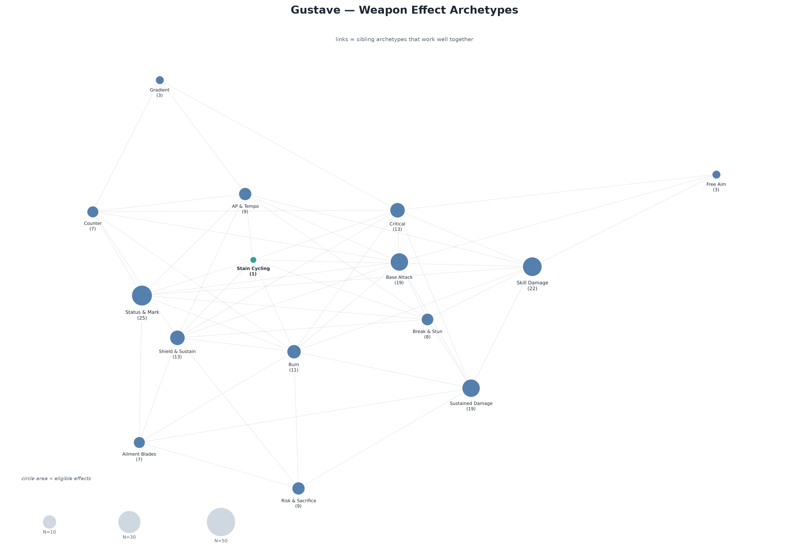
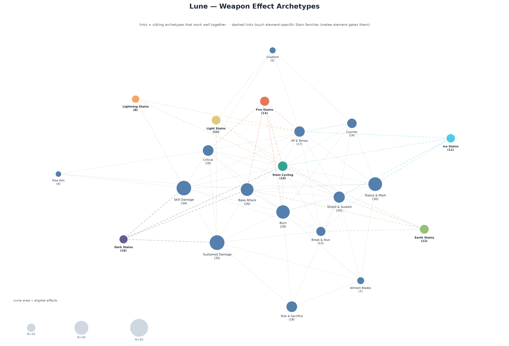
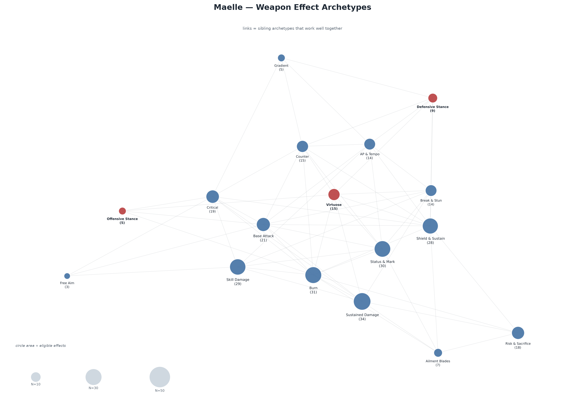
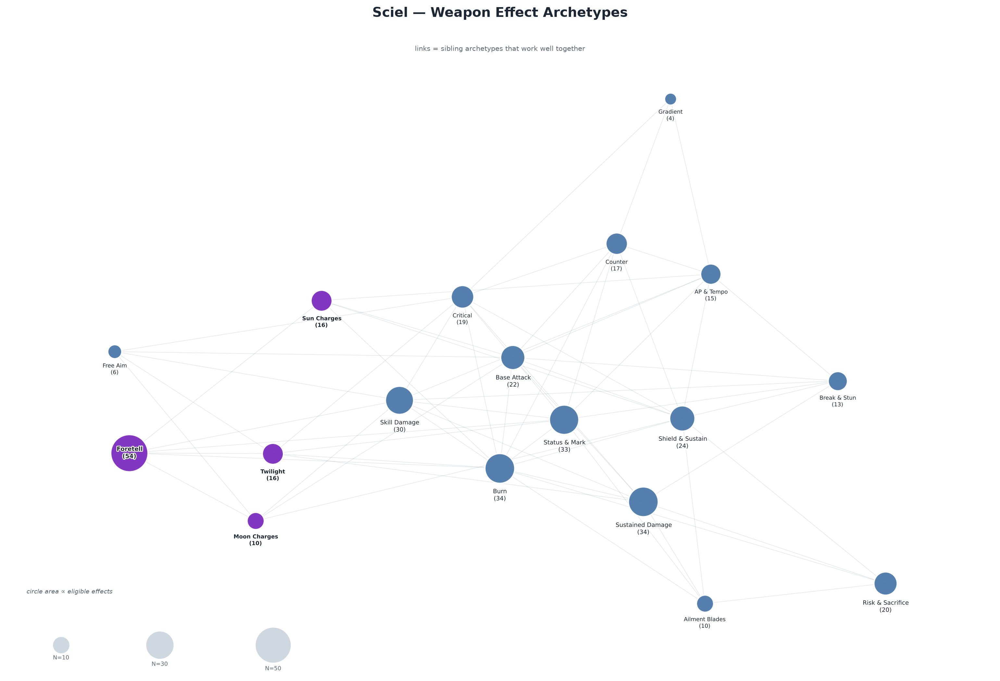
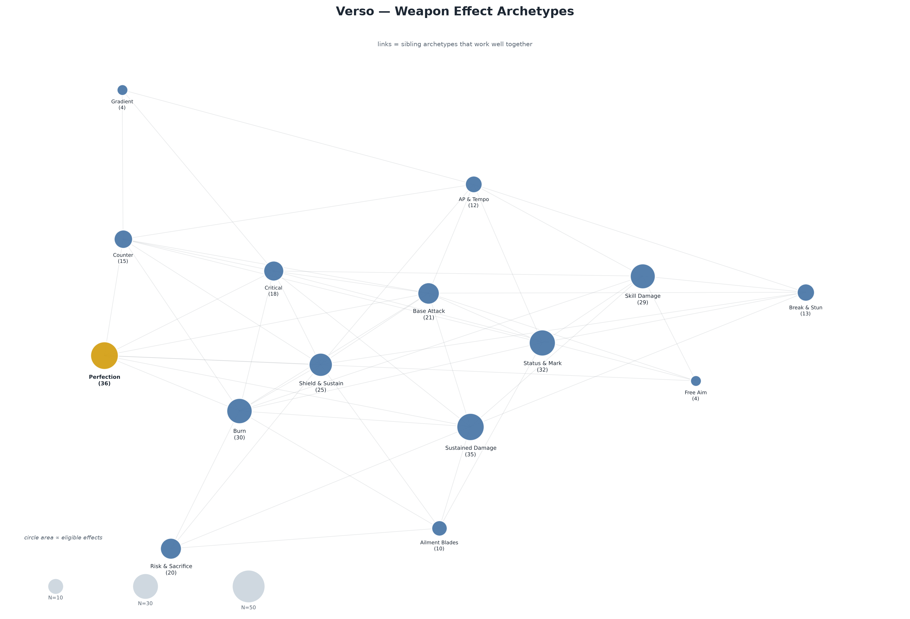
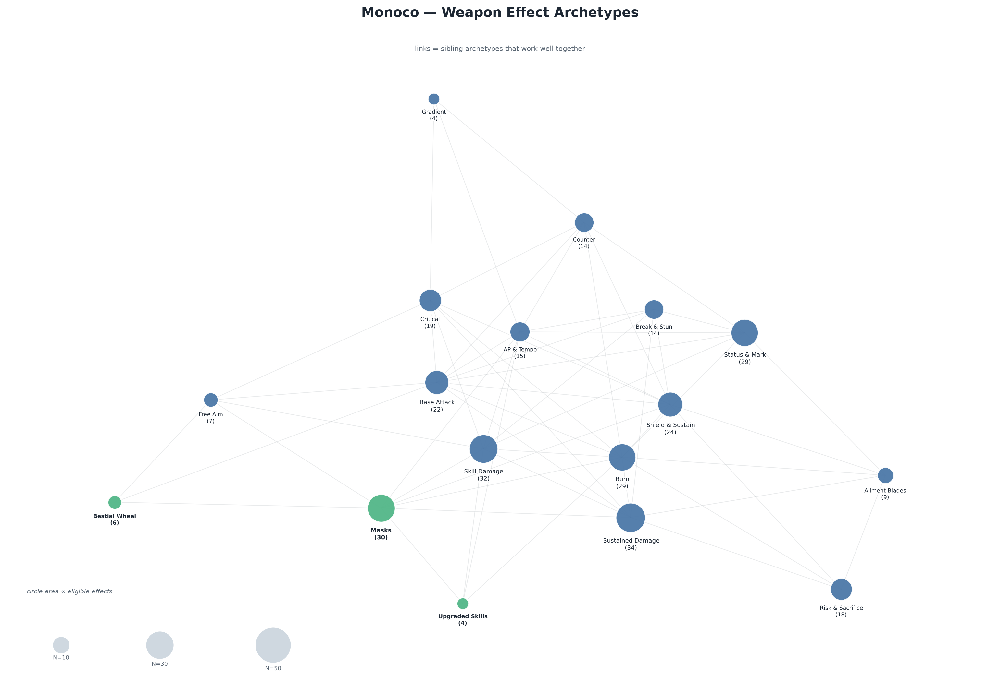

# Weapon effect archetypes — review artifacts

Generated by `build_archetypes.py` from `work/weapon_effect_tiers.json`, `work/weapon_effect_characters.json` and the custom effect specs.

- **32 archetypes**, 420 T1–T5 effects all mapped (Do Not Use excluded: WepFx_SelfBlight, FreezeSelfOnLowHP2, DefreezeAndHealOnTurnStart, AttackPropagatesBurn).
- Wildcard count per tier: 1 / 1 / 1 / 1 / 1; archetype picks: 0 / 1 / 2 / 3 / 4.
- Same archetype may repeat on one weapon; the same effect never repeats.
- Lune stain gating: melee (`BaseDamageType`) element only. Physical/Void keep the element-neutral Stain Cycling family.

## Files

- `weapon_effect_archetypes.json` — canonical archetype table + effect members
- `compatibility/<Character>.json|md` — full per-character lists and links
- `effect_archetype_map.csv` — one row per effect with its archetypes
- `<Character>.png|svg` — the pictures below

## Character images

### Gustave

### Lune

### Maelle

### Sciel

### Verso

### Monoco

